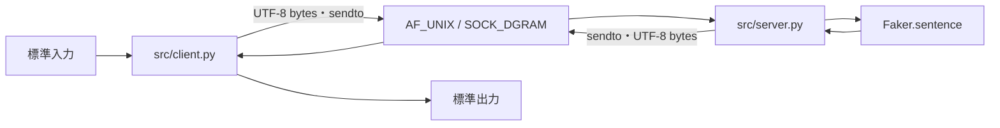

# 00 | まずここから — 3分で全体像

## このアプリがすること

- **ユーザー**がターミナルで日本語などの文章を入力する。
- **クライアント**が文章をUTF-8のバイト列にして、同じマシン上の**サーバー**へ送る。
- **サーバー**は受信した文章をログに表示し、`Faker` で架空の文章を生成する。
- サーバーが返信し、クライアントが画面に表示する。会話の意味に応じた返答ではない。

## 5つの重要コード

| コード | 何をしているか | どこにあるか |
|---|---|---|
| `socket.socket(socket.AF_UNIX, socket.SOCK_DGRAM)` | UNIXドメイン・データグラムソケットを作る | client, server |
| `sock.bind(path)` | **返信先／待受先**のローカルアドレスを登録 | client, server |
| `sock.sendto(payload, path)` | バイト列を送信 | client, server |
| `sock.recvfrom(MAX_BYTES + 1)` | バイト列と送信元アドレスを受信 | client, server |
| `message.encode('utf-8')` / `payload.decode('utf-8')` | 文字列とバイト列の変換 | protocol |

## 初回15分コース

1. **0〜3分**：上図と表を見る。
2. **3〜7分**：`src/client.py` の `send_message` を読む（作成→bind→sendto→recvfrom→片付け）。
3. **7〜11分**：`src/server.py` の `run_server` を読む（待受→受信→Faker→送信）。
4. **11〜15分**：実際に `python server.py` と `python client.py --message 'こんにちは'` を試す（仮想環境をセットアップ後）。

## 30分コース

15分コースに加え、`src/protocol.py` の全文を読み、`str` と `bytes` の違い・長さ制限・ソケット後片付けを説明できるようにする。`tests/test_integration.py` で通信テストの構造を追う。

## 60分コース

30分コースに加えて `code-walkthrough/client.md` と `code-walkthrough/server.md` を通読し、`05_REVIEW.md` の問題に解答する。

## 職種別の学習優先度

| 内容 | AI/ML | SWE | FE |
|---|---|---|---|
| クライアント・サーバー/通信フロー | 必須 | 必須 | 必須 |
| bytes・文字コード | 必須 | 必須 | 基礎 |
| `socket` の引数と通信方式 | 概要 | 重要 | 概要 |
| 例外・タイムアウト・リソース解放 | 必須 | 必須 | 重要 |
| Faker固有メソッド | 参考 | 参考 | 参考 |
| `argparse` の細かな構文 | 参考 | 重要 | 参考 |
| テスト/依存関係管理 | 必須 | 必須 | 必須 |

## 今は暗記しなくてもよい

UUIDの書式、`argparse` オプションのすべて、`Faker.sentence` のオプション、ソケットファイル名そのもの。必要になったとき参照すれば十分。ただし、**なぜクライアント側にも `bind` が要るか**は説明できるようにする。

## この課題の特性

- **同一マシン内通信**。`AF_UNIX` はIPアドレスもネットワーク上の別マシンも使わない。
- `SOCK_DGRAM` は**メッセージ単位**で扱い、`listen()`/`accept()` は不要。
- サーバーは同期型で、受信した順に処理する。
- クライアントの1回の `send_message` ごとに、一時的なクライアントソケットを作成・削除する。
