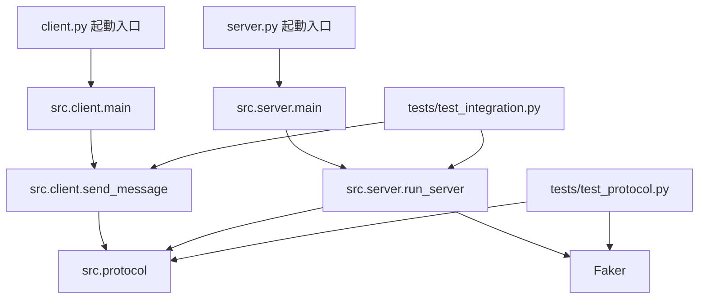

# 01 | アーキテクチャ・フォルダー間の関係

## ディレクトリツリー

```text
local-chat-messenger-3/
├── README.md                 実行手順・課題概要
├── requirements.txt          pip用の依存関係
├── pyproject.toml            Pythonプロジェクト設定
├── .gitignore                Gitの除外設定
├── server.py                 サーバー起動入口
├── client.py                 クライアント起動入口
├── src/
│   ├── __init__.py           パッケージの目印
│   ├── protocol.py           パス・バイト数・UTF-8・ファイル後片付け
│   ├── client.py             クライアント通信ロジック・CLI
│   └── server.py             サーバー通信ロジック・CLI
├── scripts/
│   ├── setup.sh              venv作成、依存関係導入
│   └── demo.sh               2件のサンプル送受信
├── tests/
│   ├── test_protocol.py      変換・長さ・ファイル保護の単体テスト
│   └── test_integration.py   実際のクライアント/サーバー通信
└── learning/                 この教材。通信の実行時には使用しない
```

## 依存関係



**役割分担**：起動ファイルは `main()` を呼ぶだけ。`src/client.py` は送信・受信、`src/server.py` は受信・返信、`src/protocol.py` は通信の共通ルールを担当します。後でコードを再利用・単体テストしやすくするためです。

## データと戻り値の一覧

| 関数 | 入力 | 出力/作用 |
|---|---|---|
| `encode_message(message)` | `str` | UTF-8 `bytes`、上限超過なら `ValueError` |
| `decode_message(payload)` | `bytes` | `str`、不正なUTF-8なら `UnicodeDecodeError` |
| `unlink_socket(path)` | `str` | UNIXソケットファイルなら削除、通常ファイルなら拒否 |
| `send_message(message, server_path, timeout)` | `str`, `str`, `float` | サーバーからの返信文字列 `str` |
| `make_reply(message, fake)` | `str`, `Faker` | Fakerのランダム文 `str`（入力内容は参照しない） |
| `run_server(path, max_messages)` | パス、任意の件数 | ループで受信・返信。通常 `None` |
| `main()` | CLI引数 | 起動・実行。通常 `None` |

## 通信先のパス

サーバー：`tempfile.gettempdir()` 内の `local_chat_messenger_3_server.sock`（通常Linuxでは `/tmp/`）。クライアント：一時ディレクトリに `lcm3_プロセスID_ランダム値.sock`。クライアントパスを送信元アドレスとして伝えることで、サーバーは応答できる。

## ネットワーク通信との違い

今回の `AF_UNIX` は同じOSの内部で通信する機構。`AF_INET` を使ったTCP・UDP通信とはアドレス形式もスコープも異なります。**`SOCK_DGRAM` という型がUDPに似ていても、このプログラムはインターネット向けUDPではありません。**
