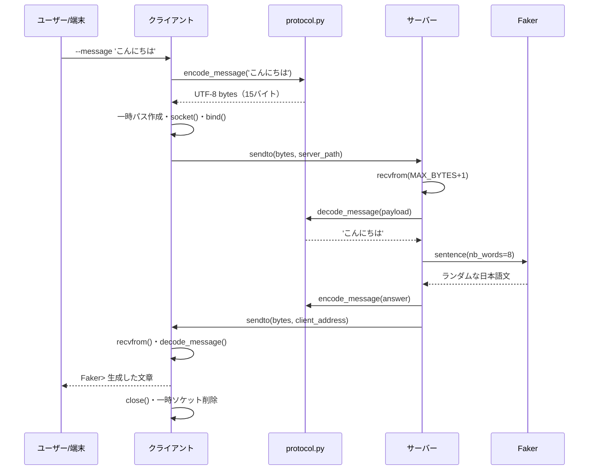

# 03 | 1回の送受信を追跡する

## 前提

サーバーを起動後、別ターミナルで次を実行：

```bash
.venv/bin/python client.py --message 'こんにちは'
```

## シーケンス図



## 処理順（コード行番号付き）

| 順序 | 場所 | 入力→結果 |
|---|---|---|
| 1 | `client.py:5` | `src.client.main()` を起動 |
| 2 | `src/client.py:34-38` | `argparse` がCLIオプションを解析 |
| 3 | `src/client.py:40-41` | `messages=['こんにちは']` |
| 4 | `src/client.py:57-59` | `send_message('こんにちは', path, 5.0)` |
| 5 | `src/protocol.py:12-17` | 文字列 → UTF-8 bytes |
| 6 | `src/client.py:17-23` | 一時パス、`bind`、`sendto` |
| 7 | `src/server.py:34-36` | `payload, address` を受信 |
| 8 | `src/server.py:40-48` | decode→Faker→encode→返信 |
| 9 | `src/client.py:24-27` | bytesを文字列に戻す |
| 10 | `src/client.py:28-30` | close・ソケットファイル削除 |
| 11 | `src/client.py:60` | `Faker> ...` を画面表示 |

## 重要なデータ型の変化

```text
str:  'こんにちは'
  ↓ encode_message
bytes: b'\xe3\x81...'  （15バイト）
  ↓ sendto → recvfrom
bytes: 受信したデータ
  ↓ decode_message
str:  'こんにちは'
  ↓ Faker（入力内容は生成に使わない）
str:  ランダムな返信文
  ↓ encode_message / sendto / recvfrom / decode_message
str:  表示する返信文
```

## `--message` を使わない対話モード

`src/client.py:44-55` が `input_messages()` を定義し、`yield` で1行ずつメッセージを返します。`/quit` またはCtrl+Cで終了、空白だけの入力はスキップします。各メッセージは**別の `send_message()` 呼び出し**になるため、クライアントの一時ソケットパスも毎回作成し直されます。

## タイムアウト・終了

クライアントは `sock.settimeout(timeout)` を設定しているため、5秒返信が来なければタイムアウト例外になり得ます。サーバーは `Ctrl+C` または `--max-messages` 件数到達で終了し、`finally` で `close()` とファイル削除をします。
